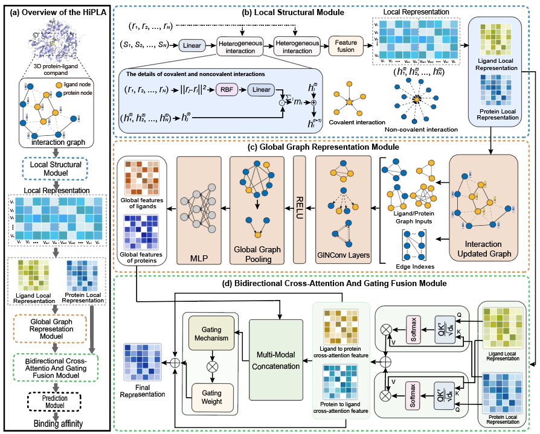

# HiPLA: An Efficient Hierarchical Graph Model for Protein–Ligand Binding Affinity Prediction

## Overview of the Architecture

## Key Contributions

  - We proposed a multi-scale learning framework, which combines the local 3D structural features of GIGN with the global topological features of GIN. Through multilevel feature representation, comprehensive modeling from atomic-level interactions to molecule-level overall structures is achieved.

  - An innovative feature fusion strategy was designed to capture the interdependence between proteins and ligands through a bidirectional cross-attention mechanism, and a gating mechanism was introduced to dynamically balance local cross-attention features and global representations, achieving adaptive feature weight adjustment.
    
  - We conducted a large number of experiments to evaluate the model, which indicated that our model outperformed the current latest methods in predicting protein-ligand binding affinity.

## Dataset
All data used in this paper are publicly available at the following locations:

- The PDBbind dataset can be downloaded [here](http://pdbbind-cn.org).

- The CSAR-HiQ dataset can be downloaded [here](http://www.csardock.org).

## Requirements  
dgl==0.9.0  
networkx==2.5  
numpy==1.19.2  
pandas==1.1.5  
pymol==0.1.0  
rdkit==2022.3.5  
scikit_learn==1.1.2  
scipy==1.5.2  
torch==1.10.2  
tqdm==4.63.0  
openbabel==3.3.1 (conda install -c conda-forge openbabel)  

## Descriptions of Folders and Files
- **`./data`:** Includes details regarding multiple datasets. Please download and structure the preprocessed data as specified.
- **`./config`:** Parameters used in HiPLA.
- **`./log`:** Logger.
- **`./model`:** Contains model checkpoints and training records.
- **Scripts and Implementations:** Various Python files implementing models, preprocessing, training, and testing.

## Step-by-step Running

### 1. Process Raw Data
- Download the preprocessed datasets and organize them in the `./data` folder.
  - `python preprocessing.py`
  - `python dataset_HiPLA.py`

### 2. Model Training And Testing
- After processing the dataset
  - `python train.py`

